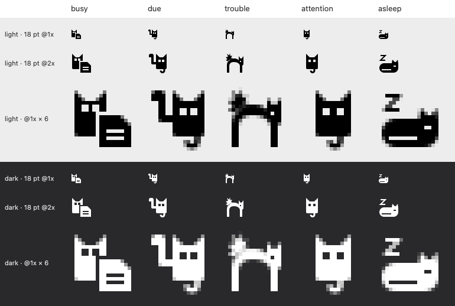

# Getting started

From nothing to a daily run in a few minutes. Nothing moves until you say so:
the setup tries flib on *copies* of your files first.

## Requirements

- The current major release of macOS (the only supported platform)
- [uv](https://docs.astral.sh/uv/) 0.13 or newer (`brew install uv`); it
  installs Python 3.11+ for you
- One AI provider ([Providers](providers.md) compares them):
    - an Anthropic API key, for the default `anthropic` provider;
    - or [Claude Code](https://code.claude.com) logged in to your Claude
      subscription, for `claude-code` (no key);
    - or [Ollama](https://ollama.com) with a model pulled, for `ollama`
      (nothing leaves your Mac);
    - or any OpenAI-compatible API, for `openai-compat`.

To try flib without any of them, set `provider: {name: fake, model: offline}`:
everything is filed under the last category, offline.

## Try it on a demo library

Before pointing flib at your own Downloads, you can look around a fictional
one. From a clone of the repository:

```sh
uv sync
uv run python -m scripts.demo /tmp/flib-demo          # --pt-BR for Brazilian Portuguese
```

It builds, in that folder only, a developer's Downloads after a few days of
flib: about 40 invented files (bills and invoices in USD and BRL, receipts, a
contract, screenshots, installers, study PDFs, photos waiting in review, a
duplicate, a credential file left in place), several daily runs, one fix and
one undo. It is offline, uses the `fake` provider, and never touches your
configuration, index, Keychain or folders. It prints the commands to explore
it, each one confined to the demo's own `HOME`:

```sh
HOME="$DEMO_HOME" "$FLIB" status -c "$CFG"
HOME="$DEMO_HOME" "$FLIB" ui -c "$CFG"
```

`uv run python -m scripts.demo /tmp/flib-demo --clean` removes it.

## Install

```sh
git clone https://github.com/luizpereiradev/file-librarian.git && cd file-librarian
./scripts/install.sh      # installs `flib` with the locked dependency versions;
                          # asks whether to add the optional MCP server
flib init                 # a few questions, a trial on copies of your files, the daily run
```

To update, `git pull` and run `./scripts/install.sh` again.

## First run: `flib init`

`flib init` asks for the language, the folder to organize and where organized
files go, the provider and, with `anthropic`, whether to turn on
[vision](configuration.md#images-and-scanned-pdfs-vision) (default no). Every
question has a default, so pressing Enter all the way gives a working setup
(`flib init --yes` takes them all without asking):

- **Provider:** `claude-code` when Claude Code is installed and logged in
  (nothing more to set up), then `ollama` when Ollama is running on this Mac
  with a model pulled (it is offered only then, and the trial checks the model
  is there), otherwise `anthropic`, and then it offers to store your API key in
  the Keychain (typed hidden, never shown). `openai-compat` is always offered:
  it asks for the server's URL and the model, and offers to store a key. So
  is `local`, the fully local setup that `flib init --local` goes straight
  to ([Nothing leaves this Mac](privacy.md#nothing-leaves-this-mac)).
- **Configuration:** written to `~/.config/file-librarian/config.yaml` (or
  `--config PATH`), readable only by you. If one exists, it is kept unless you
  confirm replacing it (`--force` replaces it without asking).
- **Trial:** your most recent items (30 by default, `--sample N`; `0` skips
  it) are *copied* to a temporary folder and classified there with a
  throwaway index. You see what would move where, what would go to review and
  the estimated cost. Nothing in your folders moves, and your real index is
  not touched; the copies are deleted afterwards. Hidden, sensitive,
  `never_send`, iCloud-only and large (over 20 MB) items are left out.
- **Daily run:** it offers to schedule it, as `flib schedule` does, and asks
  whether to run daily (the default), as files arrive
  ([watch mode](daily-use.md#or-as-files-arrive-watch-mode)) or both.

To set it up by hand instead:

```sh
mkdir -p ~/.config/file-librarian
cp config.example.yaml ~/.config/file-librarian/config.yaml
flib key set              # stores your API key in the macOS Keychain (anthropic, openai-compat)
flib check-config         # validates the configuration and finds the key
```

Then the first run, by hand:

```sh
flib simulate             # the plan for your real folder; nothing moves
flib run                  # organize now
flib undo                 # changed your mind? revert the whole run
```

## Run it every day

```sh
flib schedule                 # daily at schedule.time (12:30 by default); --at 21:00 to change
flib schedule --status        # when it runs and whether it is active
flib schedule --remove        # stop it
```

`flib schedule` installs a launchd agent, offers to move an API key that is
only in your shell into the Keychain, and then checks that a *scheduled*
process can read your folders. macOS may block background processes from
Downloads; if so, it tells you exactly which program to add under System
Settings > Privacy & Security > Full Disk Access. That program is
`flib-python`, flib's own copy of the Python interpreter, so the access you
grant covers flib only and not your other Python projects. After updating
Python or flib, `./scripts/install.sh` refreshes it (`flib schedule
--refresh`); macOS may then ask for access again.

If the Mac is asleep at the scheduled time, the run happens on wake. If it
runs while the Mac is locked and skips files that macOS protects until the
unlock, it waits for the unlock and runs once more
([details](troubleshooting.md#a-file-is-skipped-as-locked)). Each run
writes a log to `~/Library/Application Support/file-librarian/logs`, ending
with its estimated provider cost.

Rather run as files arrive? See [watch mode](daily-use.md#or-as-files-arrive-watch-mode).

## The menu bar item

```sh
flib menu            # put flib in the menu bar; it starts at login
flib menu --remove   # take it away
```


The cat from flib's icon sits in the menu bar, in the pose that says what
needs you: carrying a sheet while a run is going on, a paw raised when a
document is due soon or overdue, ruffled when flib cannot run (no key, no
access to a folder, an index it cannot read), sitting and looking at you when
files wait in review or failed, curled up asleep when nothing is pending. A
small number next to it counts what the pose is about. It follows the menu
bar's light or dark look.

{ width="420" }

Its menu is short: a line saying how things are ("2 files to review, 1
failed", "Organizing…", "Nothing pending"), when the next run is, **Open
flib** (the interface's Status page), **Review (n)** and **Due (n)** when
there is something there, **Organize now** (exactly what the daily run does;
with a run going on, it says so and does nothing), **Settings…** and **Quit**.
If a run is killed (a crash, a power cut), the menu says "The last run did
not finish" after three hours, and sooner as soon as you open `flib status`,
the interface or **Organize now**. Each "open" entry is `flib ui --open PAGE`;
when the interface is already open, it goes to that page in it.

The menu shows counts only, never a file name: the menu bar is visible to
anyone looking at your screen, and in screen sharing. The item only reads a
small state file flib writes (when a run starts and ends, after a review,
fix, undo or due change, and when the schedule changes) and runs nothing but
flib itself, with fixed arguments. It is a tiny app built on your Mac by
`flib menu` with tools that ship with macOS (`osacompile`), inside flib's own
environment, like the notifier; nothing is downloaded and nothing needs
Xcode. After **Quit** (or a crash) it stays off until the next login, or
until `flib menu`. `flib status`, `flib doctor` and the interface's
Settings page say whether it is there; `./scripts/install.sh` rebuilds it
after an update. On a Mac where it cannot be built, `flib menu` says why,
and everything else works as before.

Actions you take in an interface the menu opened, and **Organize now**
without a daily run, run on behalf of the menu bar app: macOS may ask once
whether "file-librarian" may access your Downloads folder. **Organize now**
with a daily run installed starts that run, which uses the access you gave
`flib-python`.



## Uninstalling

Run `flib menu --remove` first, and `flib schedule --remove`: the menu bar app
lives inside flib's environment, and its LaunchAgent stays in
`~/Library/LaunchAgents` until removed. Left behind, it only fails once at
each login (it never retries), but it is clutter. Your organized files stay
where they are; the index and logs are in
`~/Library/Application Support/file-librarian`, the configuration in
`~/.config/file-librarian`.

Next: [Daily use](daily-use.md).
