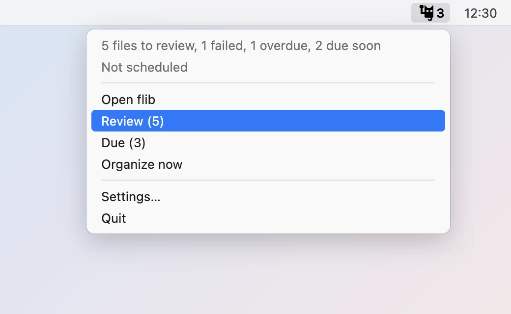
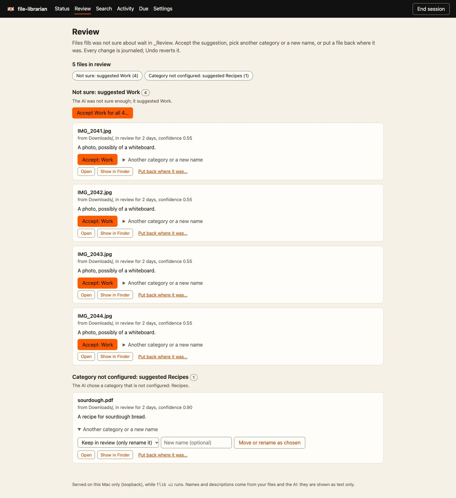
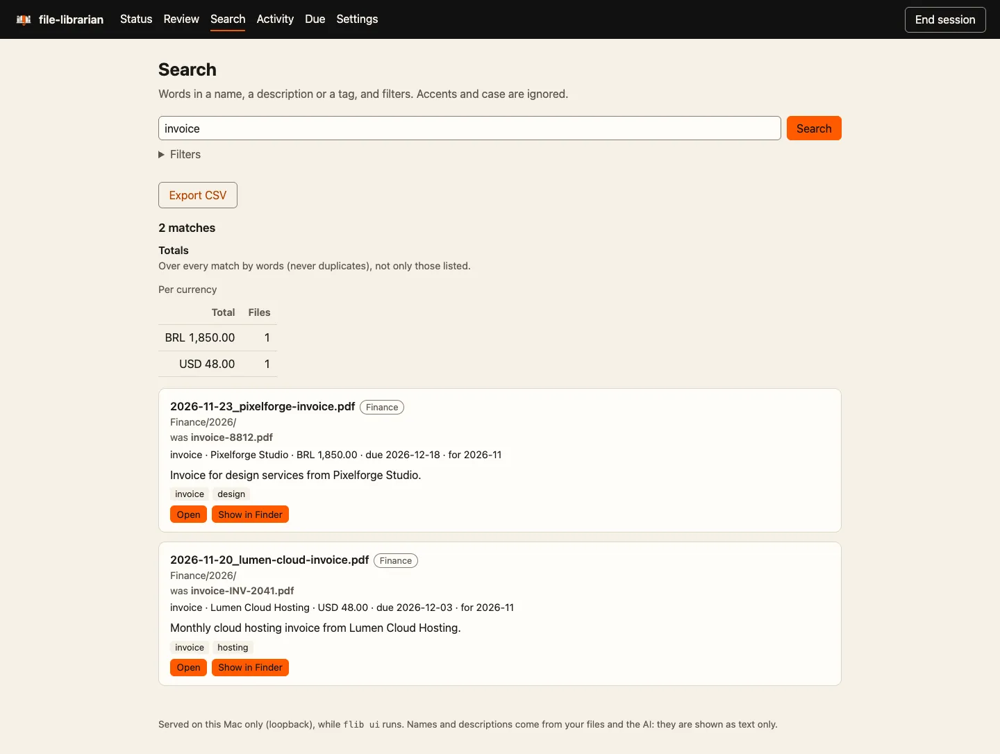

# flib

**flib keeps your Mac's Downloads folder organized: an AI reads each new file
and picks its category and name, deterministic code moves it, and a local
SQLite index finds it again.**

`documento(3).pdf` becomes `Finance/2026-10-05_water-bill.pdf`, and
`flib search "water bill"` finds it months later, with the amount and the
due date the AI read in it.

<div class="flib-strip" markdown>

<figure>

<figcaption>The cat in the menu bar says what needs you.</figcaption>
</figure>

<figure>

<figcaption>Review: accept the AI's suggestion, or correct it.</figcaption>
</figure>

<figure>

<figcaption>Search: by words, filters and amounts, totals per currency.</figcaption>
</figure>

</div>

## Install

macOS (current release) and [uv](https://docs.astral.sh/uv/) 0.13 or newer
(`brew install uv`). Then:

```sh
git clone https://github.com/luizpereiradev/file-librarian.git && cd file-librarian
./scripts/install.sh
flib init
```

`flib init` asks a few questions, tries flib on *copies* of your recent
downloads, and offers the daily run. [Getting started](getting-started.md)
walks through it.

## What leaves your Mac

- **To the AI provider you choose:** each new file's name, metadata and at most
  4,000 characters of its text. With [Ollama](providers.md#a-local-model-with-ollama-ollama), nothing at all.
- **Never:** files with credential names or secrets in them (they stay where
  they are, unread by any AI), your index, your logs, your undo history.
- **Only if you turn them on:** semantic search and the MCP server, each
  saying what it sends and where. [Privacy and safety](privacy.md) has every detail.

## What it promises

- **The AI only decides; code moves files.** Nothing is deleted, nothing is
  overwritten.
- **Every run can be undone**, one file or a whole run.
- **Secrets stay put**, and nothing is downloaded from iCloud.

!!! tip "Try it without touching your files"
    From a clone, `uv sync && uv run python -m scripts.demo /tmp/flib-demo`
    builds a fictional Downloads folder after a few days of flib, entirely
    offline, and prints the commands to explore it. See
    [Getting started](getting-started.md#try-it-on-a-demo-library).

!!! note "Status: alpha, getting ready for v0.1.0"
    Everything documented here is implemented and tested. The first release is
    tagged after two weeks of daily use
    ([#24](https://github.com/luizpereiradev/file-librarian/issues/24)); until
    then, install from the repository as shown above. macOS only.
